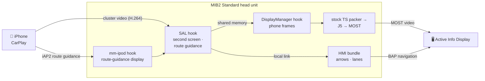

<div align="center">

# 🧭 mst2-cluster-nav

### CarPlay navigation, right in your instrument cluster

**The phone's map in the cluster's map view — and the cluster's own arrows and lane symbols,
driven by the phone's route.**
For VW Group cars with a **MIB2 Standard** head unit (TechniSat/Preh, "MST2") and the
**Active Info Display**.

**English** · [Русский](README.ru.md)


</div>

---

## ✨ What you get

<table>
<tr>
<td width="50%" valign="top">

### 🗺️ The phone's map on the cluster
Your navigation app draws a dedicated cluster map — CarPlay's second screen — and the Active Info
Display shows it in its own **Navigation** view, exactly where the built-in navigation's map would
be.

</td>
<td width="50%" valign="top">

### ↪️ Native turn arrows
Turn arrows, the approach bar, distance and time to the destination and the current street come
from the phone's route and are drawn **by the cluster itself** — the same graphics as for the
built-in navigation.

</td>
</tr>
<tr>
<td valign="top">

### 🛣️ Native lane guidance
The phone's lane instructions become the cluster's **own lane symbols**: recommended lanes lit,
side exits kept, nothing invented when the phone is unsure.

</td>
<td valign="top">

### 🚫 No "navigation on mobile device" screen
While the phone owns the cluster, the notice the stock unit shows during CarPlay guidance simply
stays away.

</td>
</tr>
</table>

## 🚀 Why it's different

> **Nothing is re-encoded. Nothing of the firmware is replaced.**

- 🎞️ **Straight into the stock video path.** The phone's H.264 enters right after the unit's own
  encoder. The stock MPEG-TS packer, the ring buffer, the J5 and MOST carry it to the cluster at
  the phone's own pace — up to **25 fps** measured, full phone quality. The stream is held to
  10 Mbit/s, what the unit's USB link and the cluster's MOST channel keep up with, and the
  built-in cluster map stops drawing while the phone's map is shown.
- 🧩 **A second CarPlay screen on a unit that never had one.** The stock CarPlay plug-in knows
  only the main screen. The mod presents the cluster as a second display, receives and decrypts
  its stream with the plug-in's own primitives, and hands every frame over without polling.
- 📡 **Route guidance the stock iAP2 driver doesn't offer.** During iAP2 identification the
  cluster is announced as a route-guidance display through one carefully checked slot of the
  stock driver; maneuvers and lanes are read straight from the driver.
- 🎯 **All 54 CarPlay maneuvers.** Roundabouts with their exit, ramps, forks, keep left/right,
  arrival on the correct side — and a U-turn drawn as a proper loop, for left- and right-hand
  traffic.
- 📐 **Made for this cluster.** One safe area that stays clear of the dials in every cluster view
  (Classic, Extended, Modern), the exact physical size the phone scales its UI from, map-only or
  map-with-maneuver-card scenes.
- 🔬 **Proven against the real firmware.** Every part was developed and tested against the
  **unmodified** head-unit and cluster firmware in **mQbEMU** — down to the cluster firmware
  drawing the lane symbols from the head unit's data.

## 🛡️ Built to fail safe

Whatever happens, the unit falls back to stock — never to a black screen.

| | |
|---|---|
| 🧪 **Trial boot** | After every install the mod loads **once**. Only you make it permanent. |
| 💾 **SD-card kill switch** | A card with an empty file `mst2-cluster-nav-disable` keeps the mod out before the HMI starts and turns every hook off within two seconds. |
| 🩺 **Self-repair guard** | Runs before every HMI start; a missing library, an HMI restart before the mod settled, or a conflicting patch — and the mod takes itself out, telling you why. |
| 💥 **Crash guards** | Every native part notices if it took its process down and switches itself off. |
| 🔍 **Build checks** | On any firmware build the mod was not verified on, it changes nothing and stays stock. |
| 📝 **Atomic edits + backups** | Three text lines are touched, written atomically, with stock copies on the unit **and** on your card. Uninstall restores them byte for byte. |

## 🔧 How it works



| Part | Where | Job |
|---|---|---|
| SAL hook | `native/src/sal/` | second CarPlay screen, cluster stream receiver, route-guidance start and reader |
| DisplayManager hook | `native/src/dm/` | the phone's frames in place of the stock encoder's while the phone owns the cluster |
| mm-ipod hook | `native/src/ipod/` | the cluster announced as a route-guidance display |
| HMI bundle | `hmi/` | arrows and lanes into the stock navigation data, the cluster notice, settings |
| Toolbox package | `toolbox/` | installer, guard, Green Engineering Menu screen |

Deep dive: [architecture](docs/ARCHITECTURE.md) · [maneuvers](docs/MANEUVERS.md) ·
[lanes](docs/LANES.md) · [what's next](docs/ROADMAP.md)

## ✅ Compatibility

| | |
|---|---|
| 🚗 **Head unit** | MIB2 Standard (TechniSat/Preh), **navigation** build. Verified on `MST2_EU_SK_ZR_P0480T`, HMI `H29.319.120`; the installer refuses other HMI builds. Reference car: Škoda, `5Q0035874C`. |
| 🖥️ **Cluster** | Continental Active Info Display 10.25" (`5E0920790A`). |
| ⚙️ **Coding** | CarPlay on. For the phone map: the cluster map over MOST on (as for the built-in navigation's map). Arrows and lanes work without it. |
| 📱 **Phone** | iPhone with CarPlay and a navigation app that supports the instrument cluster — Apple Maps, Google Maps, Yandex Maps, … |
| 🧰 **Tools** | **MIB STD2 Toolbox** installed on the unit. |

## 📦 Install

**1. Get the package** — download `mst2-cluster-nav-<version>.zip` from
[Releases](../../releases/latest), or build it yourself:

```sh
MIBHMI=<MIBHMI.jar from your unit's MIBHMI.jxe> JAVAC=<JDK 8 javac> ./package.sh
```

Building needs clang and ld.lld (no QNX SDK) and JDK 8; the HMI part is compiled against your own
unit's HMI, converted from its `MIBHMI.jxe` to a jar. Neither the package nor the repository
contains vendor files.

**2. Copy** the package's `custom/` (or `build/sd/custom/`) onto the Toolbox SD card, merging it
with the Toolbox's `custom/`.

**3. Import the menu** — Green Engineering Menu → MIB STD2 Toolbox → Customization → GreenMenu →
**Copy custom Green Engineering Menu screens and scripts to unit**, then reopen the menu.

**4. Install** — Customization → **Cluster_Navigation** → **Install / update**, and reboot.
The mod loads once. All good? → **Enable permanently**.

> [!TIP]
> Keep the card's `mst2-cluster-nav-backup/` folder — the copies of the three stock files.
> And keep a second card with an empty `mst2-cluster-nav-disable` file in the glovebox.

<details>
<summary><b>⚙️ Settings in Cluster_Navigation</b></summary>

| Item | Effect |
|---|---|
| Auto / Phone map / Native arrows only | Offer the cluster screen to the phone, or keep native arrows only. |
| 30 / 25 / 20 / 10 fps | Frame rate offered to the phone (25 by default: about what the cluster's MOST channel carries of a moving map) — lower it if the cluster video stutters. |
| Key frame every 2 s / every second | Faster recovery if the picture breaks up. |
| Map only / with the app's maneuver card | Map, route and car (default), or the app's own cluster UI. |
| Own size and safe area | Calibrate from `mst2-cluster-nav-display.txt` on the card: `width_mm height_mm x y w h`. |
| Demo guidance | See the arrows in a parked car, no phone needed. |
| Status / Save diagnostics | State and the last reason for switching off; a log for the card after a drive. |
| Uninstall | Restores the stock files — reboot afterwards. |

Changes apply from the next CarPlay connection or reboot, as the menu says.

</details>

<details>
<summary><b>🧰 Living with the Toolbox</b></summary>

- **After updating the Toolbox**, import the custom menus again (step 3) — Toolbox updates replace
  them. The mod keeps running in the meantime.
- **Before uninstalling the Toolbox**, uninstall the mod: removing the Toolbox removes the menu
  scripts, and with them the mod's Uninstall button.
- **Dual navigation** (`NavActiveIgnore.jar`) does not mix with this mod: Install refuses it, and
  if it is switched on later, the mod switches itself off.

</details>

<details>
<summary><b>❓ FAQ</b></summary>

**Does it change my firmware?** No file of the firmware is replaced. Three lines in three text
files are added and removed again on Uninstall, byte for byte.

**What if something goes wrong on the road?** The cluster falls back to the stock map or arrows on
its own. For a full stop, insert the card with `mst2-cluster-nav-disable`.

**Do I need the cluster map coded?** Only for the phone's map. Native arrows and lanes work on any
coding with CarPlay.

**Android Auto?** Not yet — it's on the [roadmap](docs/ROADMAP.md).

</details>

## 🙏 Credits

> [!NOTE]
> This project was made possible by **mQbEMU** — a not-yet-published emulator of VW MQB head
> units and instrument clusters that runs their **unmodified** firmware. Every firmware fact this
> mod relies on was found there, and every part of it was tested there before it ever went near a
> car.

## 📄 Licence

[CC BY-NC-SA 4.0](LICENSE) — see [NOTICE](NOTICE). Free for non-commercial use, sharing and
adaptation with attribution to **Anton Perk** and a link to this repository; adaptations under the
same licence. Selling builds or "paid versions" is not permitted.

This repository contains no vendor firmware, binaries or map data. Use at your own risk: modifying
a head unit may void its warranty.

<div align="center">

**Made with ☕ and a lot of emulated kilometres by Anton Perk**

</div>
