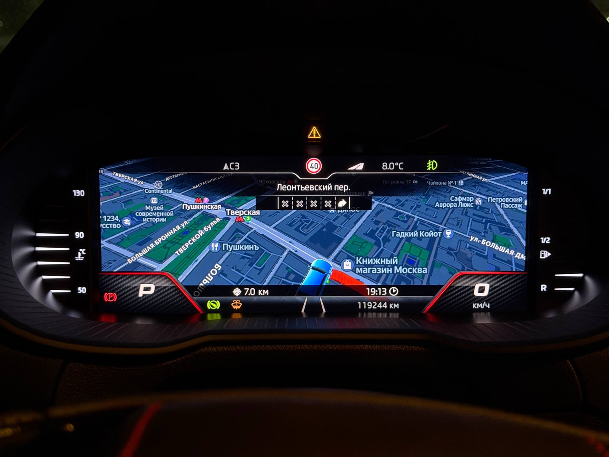
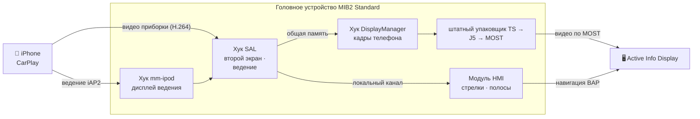

<div align="center">

# 🧭 mst2-cluster-nav

### Навигация CarPlay прямо на приборной панели

**Карта телефона — в виде «Навигация» приборки, а родные стрелки и значки полос приборки — по
маршруту из телефона.**
Для автомобилей концерна VW с головным устройством **MIB2 Standard** (TechniSat/Preh, «MST2») и
приборкой **Active Info Display**.

[English](README.md) · **Русский**



</div>

---

## ✨ Что вы получите

<table>
<tr>
<td width="50%" valign="top">

### 🗺️ Карта телефона на приборке
Навигатор рисует отдельную карту для приборки — второй экран CarPlay, — и Active Info Display
показывает её в своём виде **«Навигация»**, ровно там, где была бы карта штатной навигации.

</td>
<td width="50%" valign="top">

### ↪️ Родные стрелки
Стрелки поворотов, шкала приближения, расстояние и время до цели, текущая улица берутся из
маршрута в телефоне и рисуются **самой приборкой** — той же графикой, что у штатной навигации.

</td>
</tr>
<tr>
<td valign="top">

### 🛣️ Родные полосы
Указания по полосам из телефона превращаются в **собственные значки полос** приборки:
рекомендуемые подсвечены, боковые съезды сохранены, а там, где телефон не уверен, ничего не
выдумывается.

</td>
<td valign="top">

### 🚫 Без экрана «навигация на мобильном устройстве»
Пока приборкой владеет телефон, надпись, которую штатный блок показывает во время ведения
CarPlay, просто не появляется.

</td>
</tr>
</table>

## 🚀 Чем это отличается

> **Ничего не перекодируется. Ни один файл прошивки не заменяется.**

- 🎞️ **Прямо в штатный видеотракт.** H.264 телефона входит сразу после собственного кодера блока.
  Штатный упаковщик MPEG-TS, кольцевой буфер, J5 и MOST несут его на приборку в темпе телефона —
  измерено до **25 к/с**, в полном качестве телефона. Поток держится в пределах 10 Мбит/с — столько
  выдерживают USB блока и канал MOST до приборки, — а штатная карта приборки, пока показывается
  карта телефона, не рисуется.
- 🧩 **Второй экран CarPlay там, где его никогда не было.** Штатный плагин CarPlay знает только
  основной экран. Мод представляет приборку вторым дисплеем, принимает и расшифровывает её поток
  средствами самого плагина и передаёт каждый кадр без опроса.
- 📡 **Ведение по маршруту, которого нет в штатном драйвере iAP2.** При идентификации iAP2
  приборка объявляется дисплеем ведения через один тщательно проверенный слот штатного драйвера;
  манёвры и полосы читаются прямо из драйвера.
- 🎯 **Все 54 манёвра CarPlay.** Круговое движение с нужным съездом, съезды, развилки,
  «держитесь левее/правее», прибытие с нужной стороны — и разворот настоящей петлёй, для право- и
  левостороннего движения.
- 📐 **Сделано под эту приборку.** Одна безопасная зона, свободная от шкал во всех видах приборки
  (Классика, Расширенный, Модерн), точный физический размер, от которого телефон масштабирует
  интерфейс, сцены «только карта» и «карта с карточкой манёвра».
- 🔬 **Проверено на настоящей прошивке.** Каждая часть разработана и проверена на **неизменённой**
  прошивке головного устройства и приборки в **mQbEMU** — вплоть до того, что прошивка приборки
  рисует значки полос по данным от головного устройства.

## 🛡️ Сделано так, чтобы безопасно отказывать

Что бы ни случилось, блок возвращается к штатной работе — а не к чёрному экрану.

| | |
|---|---|
| 🧪 **Пробная загрузка** | После каждой установки мод запускается **один раз**. Постоянным его делаете только вы. |
| 💾 **Выключатель на SD-карте** | Карта с пустым файлом `mst2-cluster-nav-disable` не пускает мод до старта HMI и выключает все хуки за две секунды. |
| 🩺 **Сторож-самопочинка** | Запускается перед каждым стартом HMI: пропала библиотека, HMI перезапустился раньше, чем мод «устоялся», включён конфликтующий патч — мод сам выключается и пишет причину. |
| 💥 **Защита от падений** | Каждая нативная часть замечает, если уронила свой процесс, и выключает себя. |
| 🔍 **Проверка сборки** | На любой сборке прошивки, где мод не проверялся, он ничего не меняет и оставляет блок штатным. |
| 📝 **Атомарные правки и копии** | Меняются три строки в текстовых файлах, атомарно, с копиями штатных файлов на блоке **и** на вашей карте. Удаление возвращает их байт в байт. |

## 🔧 Как устроено



| Часть | Где | Что делает |
|---|---|---|
| Хук SAL | `native/src/sal/` | второй экран CarPlay, приём потока приборки, запуск и чтение ведения |
| Хук DisplayManager | `native/src/dm/` | кадры телефона вместо кадров штатного кодера, пока приборкой владеет телефон |
| Хук mm-ipod | `native/src/ipod/` | объявление приборки дисплеем ведения |
| Модуль HMI | `hmi/` | стрелки и полосы в штатные данные навигации, надпись приборки, настройки |
| Пакет Toolbox | `toolbox/` | установщик, сторож, экран Green Engineering Menu |

Подробности (на английском): [архитектура](docs/ARCHITECTURE.md) · [манёвры](docs/MANEUVERS.md) ·
[полосы](docs/LANES.md) · [что дальше](docs/ROADMAP.md)

## ✅ Совместимость

| | |
|---|---|
| 🚗 **Головное устройство** | MIB2 Standard (TechniSat/Preh), **навигационная** сборка. Проверено на `MST2_EU_SK_ZR_P0480T`, HMI `H29.319.120`; на других сборках HMI установщик откажет. Эталонная машина: Škoda, `5Q0035874C`. |
| 🖥️ **Приборка** | Continental Active Info Display 10,25" (`5E0920790A`). |
| ⚙️ **Кодирование** | CarPlay включён. Для карты телефона — включена карта на приборке по MOST (как для карты штатной навигации). Стрелки и полосы работают и без неё. |
| 📱 **Телефон** | iPhone с CarPlay и навигатором, поддерживающим приборку, — Apple Maps, Google Maps, Яндекс Карты, … |
| 🧰 **Инструменты** | На блоке установлен **MIB STD2 Toolbox**. |

## 📦 Установка

**1. Возьмите пакет** — скачайте `mst2-cluster-nav-<версия>.zip` из
[Releases](../../releases/latest) или соберите сами:

```sh
MIBHMI=<MIBHMI.jar из MIBHMI.jxe вашего блока> JAVAC=<javac из JDK 8> ./package.sh
```

Для сборки нужны clang и ld.lld (QNX SDK не нужен) и JDK 8; часть для HMI компилируется против HMI
вашего собственного блока, переведённого из `MIBHMI.jxe` в jar. Ни в пакете, ни в репозитории нет
файлов производителя.

**2. Скопируйте** `custom/` из пакета (или `build/sd/custom/`) на SD-карту Toolbox, объединив с его
`custom/`.

**3. Импортируйте меню** — Green Engineering Menu → MIB STD2 Toolbox → Customization → GreenMenu →
**Copy custom Green Engineering Menu screens and scripts to unit**, затем откройте меню заново.

**4. Установите** — Customization → **Cluster_Navigation** → **Install / update** и перезагрузите
блок. Мод запустится один раз. Всё в порядке? → **Enable permanently**.

> [!TIP]
> Сохраните папку `mst2-cluster-nav-backup/` с карты — это копии трёх штатных файлов.
> И держите в бардачке вторую карту с пустым файлом `mst2-cluster-nav-disable`.

<details>
<summary><b>⚙️ Настройки в Cluster_Navigation</b></summary>

| Пункт | Что делает |
|---|---|
| Auto / Phone map / Native arrows only | Предлагать телефону экран приборки или оставить только родные стрелки. |
| 30 / 25 / 20 / 10 fps | Частота кадров для телефона (по умолчанию 25: примерно столько движущейся карты пропускает канал MOST до приборки) — снизьте, если видео на приборке дёргается. |
| Key frame every 2 s / every second | Быстрее восстанавливать картинку, если она «сыплется». |
| Map only / with the app's maneuver card | Карта, маршрут и автомобиль (по умолчанию) или собственный интерфейс приложения для приборки. |
| Own size and safe area | Калибровка из `mst2-cluster-nav-display.txt` на карте: `ширина_мм высота_мм x y w h`. |
| Demo guidance | Посмотреть стрелки на стоянке, без телефона. |
| Status / Save diagnostics | Состояние и причина последнего выключения; журнал на карту после поездки. |
| Uninstall | Возвращает штатные файлы — затем перезагрузка. |

Изменения действуют со следующего подключения CarPlay или перезагрузки — это написано в меню.

</details>

<details>
<summary><b>🧰 Жизнь рядом с Toolbox</b></summary>

- **После обновления Toolbox** снова импортируйте меню (шаг 3) — обновление Toolbox их заменяет.
  Сам мод при этом продолжает работать.
- **Перед удалением Toolbox** удалите мод: удаление Toolbox стирает скрипты меню, а вместе с ними и
  кнопку Uninstall мода.
- **Двойная навигация** (`NavActiveIgnore.jar`) с этим модом не сочетается: установка при ней
  отказывает, а если её включить позже, мод сам выключится.

</details>

<details>
<summary><b>❓ Вопросы и ответы</b></summary>

**Мод меняет прошивку?** Ни один файл прошивки не заменяется. В три текстовых файла добавляются
три строки, а при удалении они убираются байт в байт.

**Что, если что-то пойдёт не так в дороге?** Приборка сама вернётся к штатной карте или стрелкам.
Чтобы остановить мод полностью, вставьте карту с `mst2-cluster-nav-disable`.

**Нужна ли закодированная карта на приборке?** Только для карты телефона. Родные стрелки и полосы
работают при любом кодировании с CarPlay.

**Android Auto?** Пока нет — он в [планах](docs/ROADMAP.md).

</details>

## 🙏 Благодарности

> [!NOTE]
> Этот проект стал возможен благодаря **mQbEMU** — ещё не опубликованному эмулятору головных
> устройств и приборок VW MQB, который исполняет их **неизменённую** прошивку. Каждый факт о
> прошивке, на который опирается мод, найден там, и каждая его часть проверена там, прежде чем
> оказаться рядом с машиной.

## 📄 Лицензия

[CC BY-NC-SA 4.0](LICENSE) — см. [NOTICE](NOTICE). Свободно для некоммерческого использования,
распространения и изменения с указанием автора **Anton Perk** и ссылкой на этот репозиторий;
производные работы — под той же лицензией. Продавать сборки или «платные версии» нельзя.

В репозитории нет прошивок, бинарных файлов производителя и картографических данных. Всё на свой
риск: изменение головного устройства может лишить его гарантии.

<div align="center">

**Сделано с ☕ и множеством эмулированных километров — Anton Perk**

</div>
